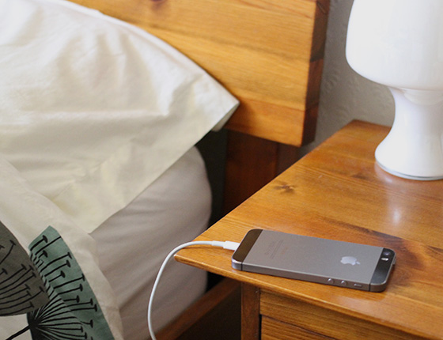
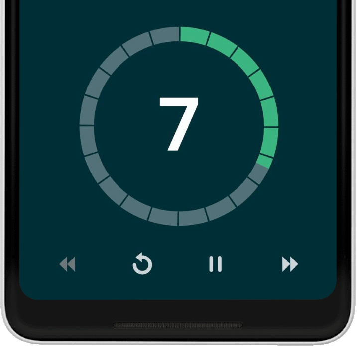
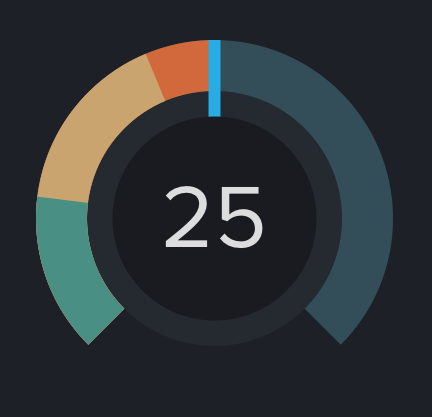
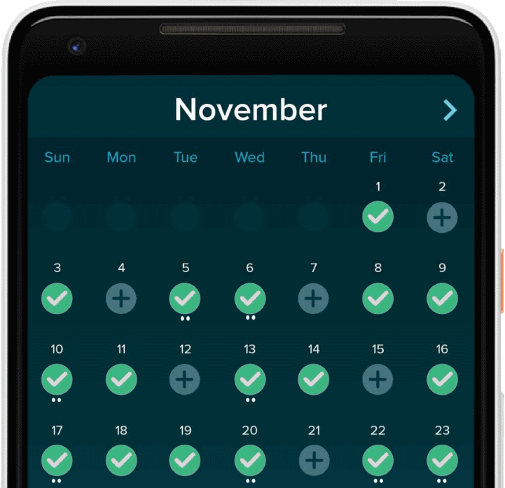
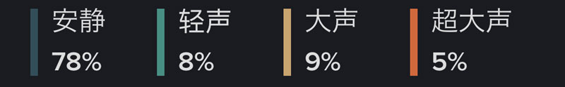
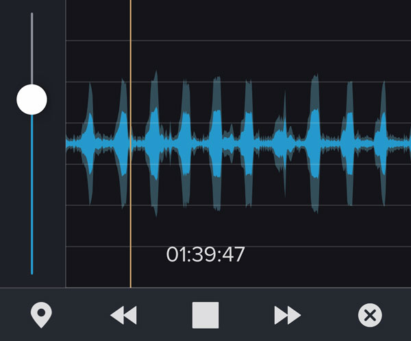
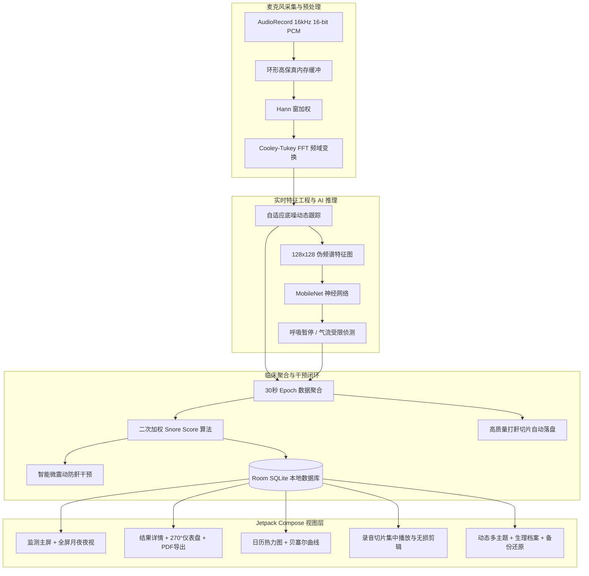

# SleepSnoreDetector 🌙💤

<p align="center">
  
</p>

<p align="center">
  <strong>高性能、临床级 Android 睡眠打鼾监测与分析应用</strong><br>
  A high-performance, clinical-grade sleep & snore monitoring Android application.<br>
  1:1 深度复刻业界标杆应用 <strong>SnoreLab (鼾声分析器 / 打鼾实验室)</strong> 核心架构、原生资产与临床算法。
</p>

<p align="center">
  <a href="https://github.com/FumasterLin/sleep-snore-app/releases"></a>
  <a href="https://developer.android.com"></a>
  <a href="https://kotlinlang.org"></a>
  <a href="https://developer.android.com/jetpack/compose"></a>
  <a href="https://www.tensorflow.org/lite"></a>
  <a href="LICENSE"></a>
</p>

---

## 📖 目录 (Table of Contents)

- [🌟 项目简介 (Overview)](#-项目简介-overview)
- [✨ 核心特性矩阵 (Key Features)](#-核心特性矩阵-key-features)
- [📸 界面预览与视觉呈现 (Screenshots)](#-界面预览与视觉呈现-screenshots)
- [📐 临床算法与声学数学模型 (Algorithms & DSP)](#-临床算法与声学数学模型-algorithms--dsp)
- [🏗️ 系统架构图 (Architecture)](#️-系统架构图-architecture)
- [🛠️ 技术栈清单 (Tech Stack)](#️-技术栈清单-tech-stack)
- [📦 快速上手与编译运行 (Getting Started)](#-快速上手与编译运行-getting-started)
- [🔒 隐私与离线保证 (Privacy First)](#-隐私与离线保证-privacy-first)
- [🩺 医学免责声明 (Medical Disclaimer)](#-医学免责声明-medical-disclaimer)
- [📄 开源协议 (License)](#-开源协议-license)

---

## 🌟 项目简介 (Overview)

**SleepSnoreDetector** 是一款完全自主实现、纯离线、无广告且隐私零上传的专业睡眠呼吸健康监测工具。项目以医学声学信号处理为基石，1:1 深度复刻了全球知名的 **SnoreLab** 商业应用：

- 🔒 **100% 离线端侧运算**：麦克风采集数据直接经底层 DSP 与端侧 MobileNet 神经网络推理，不依赖网络，不上传任何音频或生理数据。
- 📊 **临床级二次加权算法**：严格复刻 SnoreLab 专利级二次加权打鼾评分体系（Snore Score），并提供整夜 30s 分辨率声谱时间轴。
- 📱 **纯现代 Compose 纯净架构**：单 Activity + Jetpack Compose Material 3 边到边沉浸式设计，原生支持深色/亮色/跟随系统三模式无缝切换。

---

## ✨ 核心特性矩阵 (Key Features)

### 1. 深度学习与底层 DSP 信号处理管线
- **MobileNet TFLite 神经网络推理**：内置 12.8MB 临床级 `mobilenet.tflite` 模型，将 16kHz PCM 音频切片转换为 128×128 多频带梅尔伪频谱图，实时监测呼吸气流状态（平稳呼吸、气流受限、疑似呼吸暂停 Apnea），显著降低翻身杂音与环境误报。
- **高保真音频采集**：16kHz 16-bit 单声道 PCM 流式采集（打鼾分析黄金采样率）。
- **底层 DSP 频域分析**：汉宁窗 (Hann Window) 加窗 + 基-2 Cooley-Tukey FFT 变换，提取 100Hz ~ 1000Hz 悬雍垂/软腭共振特征带。
- **动态自适应底噪跟踪**：平滑消除室内空调与风扇恒定背景白噪声。

### 2. 五大核心主屏与 1:1 官方原版视觉布局
1. **监测页面 (Record)**：
   - **夜视动态微光星空微粒系统 (Stars Particle Background)**：65 颗夜空星尘微粒，呼吸光晕伴随微光闪烁，环绕月亮外围优雅浮动，营造逼真宁静的深邃夜空沉浸感。
   - **潮汐沉浸流体水波视效 (FluidWaveVisualizer)**：基于三阶贝塞尔曲线与正弦谐波的动态水波，随白噪音播放柔和起伏。
   - **2x2 黄金比例大功能卡片 (SnoreLab Four Large Cards)**：延迟入睡时间（0~60分钟）、录音模式（智能切片/整夜/仅统计）、止鼾对策（18 项防鼾用品网格）、影响因素（14 项身心诱因网格）。
   - **下移优化 114dp 发光大圆 START 按钮**：平缓呼吸光晕，处于单手舒适点击黄金区。
   - **月亮星空夜视界面 (Night View)**：中心月亮夜钟、防误触左右滑动停止栏（Slide to Stop）。
   - **正面朝下超低功耗自动息屏 (Proximity Screen Off)**：距离传感器联合重力加速度计（$Z < -6.5\text{ m/s}^2$）感应平放，进入 AMOLED 纯黑极低功耗，翻转拿起即亮。
   - **智能微震动防鼾干预 (Smart Vibration)**：检测到连续大声打鼾超过 60 秒时，触发短促轻微震动提醒翻身改善呼吸。
   - **智能浅睡轻柔唤醒闹钟 (Smart Sleep Cycle Alarm)**：监测唤醒窗口期用户浅睡翻动状态，提前渐进低音量唤醒。

2. **结果详情页面 (Results)**：
   - **交互式整夜时间轴直方图 (SnoreGraphView)**：支持双指捏合缩放（1.0x~4.5x）与光标点击定位，红三角标记疑似呼吸暂停（Apnea）。
   - **真实 WAV 音频波形包络播放器 (Real Waveform Envelope)**：读取真实音频 PCM 提取振幅包络，播放光标随声音起伏；左侧垂直音量条、5 键快退/快进/收藏/关闭控制。
   - **官方 270° 弧形打鼾评分速度表 (ScoreRoundChart)**：底部缺口圆弧，大号加粗数字评分，发光圆点游标随分数精准指示。
   - **🕸️ 五维睡眠呼吸健康雷达图 (SleepRadarChart)**：打鼾控制、气流通畅、安睡静音、呼吸平稳、晨起精力 5 维多边形量化。
   - **🔬 鼾声解剖生理来源分类诊断**：软腭/悬雍垂震颤 (350~850Hz)、舌后坠深沉鼾声 (100~320Hz) 与呛咳喘鸣高频突破 (>950Hz)。
   - **疑似睡眠呼吸暂停 (Apnea / AHI) 评估看板**：统计整夜暂停事件与预估 AHI 指数，给出正常/轻度/中度/重度临床指引。
   - **一键导出专业医生医学睡眠报告 (Medical PDF Export)**：使用 Android 原生矢量 `PdfDocument` 自动排版并生成 A4 标准格式诊断 PDF，包含患者生理信息、整夜直方图、四级耗时条、AHI 风险评级与医学免责声明。
   - **四分级标准原版配色**：安静 (`#344E59`)、轻声 (`#488E83`)、大声 (`#C9A36E`)、超大声 (`#D1693C`)。
   - **切片列表与无损精准剪辑 (Audio Trimmer)**：双向范围滑块剪辑器，实时试听，一键导出分享。

3. **趋势对比页面 (Trends)**：
   - **打鼾日历 (Calendar Heatmap)**：月历网格每天呈现打鼾评分徽章，点击直达当夜详情。
   - **📈 三阶贝塞尔平滑流光曲线 (SmoothSplineChart)**：计算三次贝塞尔控制点，带 `#29B6F6` 渐变流光与 30/60 分警戒参考线。
   - **⚖️ 止鼾用具 A/B 临床对照分析矩阵 (Remedy A/B Matrix)**：双侧柱条直观对比使用某用具 vs 未用对照的打鼾均分、改善百分比，给出星级评定。

4. **录音片库页面 (Recordings)**：
   - 跨夜全部打鼾音频集中管理，支持按超大声 (>65dB)、大声 (50-65dB)、轻度、星标收藏多维过滤，内置无损剪辑与系统分享。

5. **洞察与设置页面 (Settings)**：
   - **🎨 多主题视觉自适应引擎 (Dark / Light / Follow System)**：深色模式 (`#181B21`)、亮色模式 (`#F6F8FA` 底色 + 纯白卡片)、跟随系统，边到边沉浸式贴合，夜视界面保持独立深空纯黑护眼。
   - **睡眠生理档案与 BMI**：记录性别、年龄、身高、体重，自动计算 BMI 指数并分析气道脂肪压迫风险。
   - **AI 睡眠改善建议**：根据打鼾数据自动生成个性化医学指导。
   - **💾 数据全量备份与跨平台迁移**：支持导出 JSON 结构化整机备份、导出科研用 CSV 报表、一键从 JSON 备份文件无损恢复。
   - **打鼾医学指南与常见问题 FAQ**：打鼾成因、OSA 危害与止鼾用具原理深度科普。

---

## 📸 界面预览与视觉呈现 (Screenshots)

| 监测主屏 (Record) | 夜视月面 (Night View) |
| :---: | :---: |
|  |  |

| 结果与评分仪表盘 (Results) | 趋势日历与平滑曲线 (Trends) |
| :---: | :---: |
|  |  |

| 分级标准体系 (Volume Ratings) | 波形回放控制 (Audio Controls) |
| :---: | :---: |
|  |  |

---

## 📐 临床算法与声学数学模型 (Algorithms & DSP)

### 1. 二次加权打鼾评分体系 (Snore Score Formulation)

SnoreLab 的打鼾评分并不是简单的“平均分贝”，而是采用非线性二次加权算法，重点惩罚破坏性高的大声鼾声（Loud / Epic）：

$$\text{Snore Score} = \sum_{k \in \{\text{Quiet}, \text{Mild}, \text{Loud}, \text{Epic}\}} W_k \cdot \left(\frac{T_k}{T_{\text{total}}}\right)^{\alpha} \cdot \bar{D}_k$$

其中：
- $T_k$：该级别累计持续秒数，$T_{\text{total}}$：总卧床监测秒数。
- $W_k$：级别权重系数（Quiet: 0.2，Mild: 1.0，Loud: 3.5，Epic: 8.0）。
- $\bar{D}_k$：该分级窗口内的归一化声压级倍率。
- 最终得分在 $0 \sim 150+$ 范围内映射，经典临床基准线：$<15$ (正常), $15\sim 30$ (轻微), $30\sim 60$ (大声), $>60$ (极响亮，高危)。

### 2. 鼾声频谱解剖分类 (Anatomical Source Classification)

应用对 16kHz 原始 PCM 数据执行 1024 点 FFT，提取关键共振峰能量占比：
- **软腭与悬雍垂震颤 (Palatal)**：特征共振峰位于 $350\text{ Hz} \sim 850\text{ Hz}$。
- **舌后坠与舌根部鼾声 (Tongue Base)**：深沉沉闷低频，峰值集中于 $100\text{ Hz} \sim 320\text{ Hz}$。
- **气道狭窄呼吸暂停后呛咳突变 (Epiglottic / Apnea Break)**：具有 $>950\text{ Hz}$ 的高频喷气突破特征。

---

## 🏗️ 系统架构图 (Architecture)



---

## 🛠️ 技术栈清单 (Tech Stack)

| 领域 | 核心技术 / 库 | 用途与说明 |
| :--- | :--- | :--- |
| **编程语言** | Kotlin 1.9.0 | 现代简洁、空安全、全协程异步响应式支持 |
| **UI 架构** | Jetpack Compose + Material 3 | 单 Activity 纯声明式 UI，自适应明暗双主题 |
| **底层 DSP** | JNI + Cooley-Tukey FFT | 16kHz 快速频域变换与悬雍垂共振特征提取 |
| **端侧 AI 推理** | TensorFlow Lite 2.14.0 | 离线执行 `mobilenet.tflite` 呼吸气流与呼吸暂停分类 |
| **本地数据库** | Room 2.6.1 + SQLite | 本地结构化持久存储会话、波形点集与音频样本元数据 |
| **后台保活** | Android 14 前台服务 (`FOREGROUND_SERVICE_MICROPHONE`) | `PARTIAL_WAKE_LOCK` + 稳定整夜音频采集不被系统查杀 |
| **硬件传感器** | SensorManager (Proximity + Accelerometer) | 距离传感器与重力感应器协同实现正面朝下自动极低功耗息屏 |
| **报表导出** | Android 原生矢量 `PdfDocument` | 自动矢量排版输出 A4 医学睡眠诊断报告 PDF |
| **桌面小组件** | AppWidgetProvider | 桌面常驻昨夜打鼾评分与快捷开启监测看板 |

---

## 📦 快速上手与编译运行 (Getting Started)

### 编译环境要求 (Prerequisites)
- **Android Studio**：Hedgehog (2023.1.1) 或更高版本
- **JDK**：OpenJDK 17
- **Android SDK**：Compile SDK 34，Min SDK 26 (Android 8.0+)
- **NDK**：25.1+ (用于预编译 JNI 动态库支持)

### 源码编译 (Build from Source)

```bash
# 1. 克隆代码仓库
git clone https://github.com/FumasterLin/sleep-snore-app.git
cd sleep-snore-app

# 2. 命令行一键编译生成 Debug APK
./gradlew assembleDebug

# 3. 安装至已连接的 Android 设备
adb install -r app/build/outputs/apk/debug/app-debug.apk
```

---

## 🔒 隐私与离线保证 (Privacy First)

- **零数据上报**：本应用不包含任何第三方分析统计 SDK，不请求互联网联网权限 (`android.permission.INTERNET` 未声明)。
- **物理离线**：全部音频录音和睡眠健康评分仅存放于设备内部私有存储目录 (`Context.getExternalFilesDir`)，用户卸载应用或在设置中点击清空即彻底销毁。
- **开源透明**：代码 100% 开源，任何人可审查音频数据流向。

---

## 🩺 医学免责声明 (Medical Disclaimer)

> [!IMPORTANT]
> **SleepSnoreDetector 仅供日常睡眠健康管理、生活方式参考与个人打鼾规律探查使用，不属于国家药监局或 FDA 认证的二类/三类医疗器械。**
> 
> 本应用提供的疑似睡眠呼吸暂停 (Apnea) 提示、AHI 预估指数以及鼾声生理分类不能代替执业专科医生的多导睡眠监测 (Polysomnography, PSG) 诊断。如果您在日常生活中经常出现日间不可抗拒性嗜睡、晨起严重口干头痛、夜间频繁憋醒或伴有高血压等心脑血管疾病，请及时前往正规医院睡眠呼吸障碍专科就诊。

---

## 📄 开源协议 (License)

本项目基于 [Apache License 2.0](LICENSE) 协议开源。欢迎提交 Issue 与 Pull Request 共同改进！
